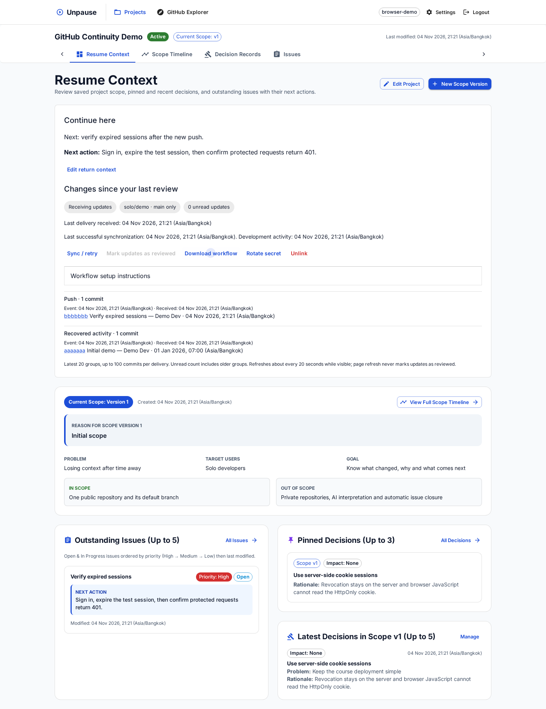

# สรุปผล GitHub Continuity — Unpause

> ผลในเอกสารนี้เป็น baseline ก่อนแก้ dependencies; ดูผลแก้ไขและการทดสอบล่าสุดใน [รายงาน dependency remediation](UNPAUSE_DEPENDENCY_REMEDIATION_TH.md)

วันที่ 4 พฤศจิกายน 2026 (Asia/Bangkok) · Branch: `codex/github-continuity` · ฐานเริ่มต้น: `develop` / `31f2e81`

## ผลที่ส่งมอบ

เพิ่ม GitHub Continuity MVP ตามแผนสำหรับ Go API และ React แล้ว ตรวจการทำงานในเครื่องผ่านทั้ง API tests และ browser จริง ส่วนการส่งจาก GitHub Actions และการตื่นจาก idle ของ Render/Neon จริงยังไม่ได้ทดสอบ จึงยังไม่ถือว่าผ่าน exit criteria บน deployment ทั้งหมด

1. เชื่อม public repository หนึ่งแห่งต่อโปรเจกต์ อ่าน stable ID/default branch จาก GitHub, แสดงสถานะ pending/receiving/syncing/error/paused และให้ rotate/unlink ได้
2. สร้าง secret สุ่มแยกต่อ connection แสดงครั้งเดียว เก็บเฉพาะ hash ให้ workflow ส่งข้อมูลด้วย Bearer ผ่าน HTTPS และรับข้อมูลได้โดยไม่ใช้ browser session
3. บันทึก delivery และ commits ใน transaction พร้อม unique constraints กันข้อมูลซ้ำ ตรวจ connection/repository/branch และปฏิเสธ payload ไม่ตรง schema
4. หน้า Resume แสดงกิจกรรมเป็นกลุ่ม, source links, เวลา event/receipt/sync แยกกัน และ refresh ประมาณ 20 วินาทีระหว่างมองเห็นหน้า
5. เพิ่ม return note และ focus issue ที่แสดง next action ที่เลือก แม้ issue จะหลุดจากรายการ outstanding ห้าอันดับแรก หากลบ issue จะล้าง focus โดยไม่ลบบันทึก
6. กดยืนยันอ่านแล้วด้วย sequence จาก snapshot เอง การ reload ไม่เลื่อน marker; ข้อมูลที่ส่งล่าช้ายัง unread ตามลำดับรับ ไม่ตามเวลา commit
7. เพิ่ม public API catch-up สูงสุด 100 commits, stale check, cooldown/lease กัน sync ซ้อน, cached context เมื่อ upstream ล่ม และแสดง incomplete history เมื่อเกิน window/ประวัติเปลี่ยน
8. Archive หยุดเขียนข้อมูล integration; unlink revoke credential และล้าง cache/review state โดยคงบริบทที่เจ้าของเขียน
9. เพิ่ม workflow ดาวน์โหลดได้, script เตรียมโปรเจกต์เดโม และคู่มือติดตั้ง/เดโม/วัดผลจริงภาษาไทย

ไฟล์เดิมที่แก้คือ router เพื่อเพิ่ม endpoints, ResumeContextPage เพื่อแสดง component ใหม่ และ Dockerfile เพิ่ม COPY workflow template ที่ frontend ต้องใช้ตอน build นอกนั้นเพิ่มไฟล์เฉพาะ integration, migration, tests และเอกสาร ไม่แก้ implementation ของ auth, Scope, Decision, Issue, Render config หรือ dependency versions เอกสารต้นทางที่มีอยู่ใน `docs/` คงเดิม

## ผลทดสอบ

| รายการ | ผล |
|---|---|
| `npm test` — Go API | ผ่าน 7 กลุ่มทดสอบหลัก รวม 31 subtests เดิม และ integration scenario ใหม่ที่ตรวจหลายกรณีต่อเนื่อง |
| `npm test` — React | ผ่าน 10 tests รวม unread, polling 20 วินาที, upstream failure, archive, return note และ focus issue |
| `npm run test:api:node` | ผ่าน 19 tests ของ Node API ทางเลือกเดิม (ยังไม่ได้เพิ่ม integration ให้ Node API) |
| `python3 scripts/test-github-workflow.py` | ผ่าน 4 tests: retry payload เดิม, 401 หยุดทันที, retry สูงสุด 5 ครั้ง, payload ภาษาไทยไม่เกิน 256 KiB |
| Workflow YAML | parse ผ่าน ตรวจ push branch และ `contents: read` |
| `npm run build` | ผ่าน Go server/migrate/seed และ TypeScript/Vite production build |
| `go vet ./...` | ผ่าน |
| `go test -race ./...` | ผ่าน ไม่พบ data race ในเส้นทางที่ทดสอบ |
| Chromium desktop/mobile | ผ่าน login, demo setup, link repo, secret, polling, reload unread, review, return note และดาวน์โหลด workflow |
| Layout | ตรวจภาพ desktop 1440 px และ mobile 390 px ไม่พบ horizontal overflow หรือ browser runtime error |
| `git diff --check` | ผ่าน |

API scenario ใหม่ครอบคลุม: secret สุ่มผิด/secret ของอีก connection, repository/branch ผิด, ข้ามเจ้าของ, ข้าม project focus issue, duplicate delivery, dedup ระหว่าง Actions กับ recovery, late delivery, marker ในอนาคต, GitHub ล่ม, repo identity เปลี่ยน, full history window, rewrite, rotation, archive/restore, unlink/cascade และไม่เปลี่ยน `Project.updatedAt` จาก background sync

Migration ทดสอบบนฐานข้อมูลใหม่และฐานข้อมูล Prisma เดิมผ่าน suite ที่มีอยู่ ข้อมูลทดสอบใช้ PGlite PostgreSQL ในหน่วยความจำแยกจากข้อมูลจริง การทดสอบนี้ยังไม่แทนโหลดพร้อมกันหลาย connection บน Neon จริง

## เวลาที่วัดได้ในเครื่อง

| รายการ | ผลรอบสุดท้าย |
|---|---|
| เริ่มส่ง delivery HTTP → รับ 200 หลังเก็บสำเร็จ | 37 ms |
| เก็บสำเร็จ → commit ปรากฏใน UI ผ่าน polling | 20,157 ms (ประมาณ 20.2 วินาที) |

สภาพแวดล้อม: Chromium + production React assets + compiled Go API + ฐานข้อมูล PostgreSQL แบบ PGlite ในหน่วยความจำ + GitHub stub บน localhost ตัวเลขแรกวัดตั้งแต่เริ่มส่ง HTTP จนรับ 200 หลัง transaction สำเร็จ จึงไม่ใช่เวลา push → stored; ตัวเลขที่สองวัดจนพบ commit link ใน browser จริง ไม่ใช่การสมมติจาก interval

ทดสอบ reload ก่อนกดยืนยันแล้ว unread ยังอยู่ หลังยืนยันเป็น 0 และการแก้ return note ไม่สร้าง Decision/Scope หรือปิด Issue

## ตรวจความปลอดภัย

ข้อควบคุมที่ทดสอบผ่านสำหรับฟีเจอร์ใหม่:

- Credential 256 บิตจาก crypto RNG, SHA-256 digest ใน DB, constant-time comparison, response สร้าง/rotate เป็น `Cache-Control: no-store`, secret ไม่อยู่ใน normal view/cache ของ query
- Owner isolation และ project ownership เดิมยังใช้กับทุก owner endpoint; delivery หา project จาก connection และไม่ยอมรับ `projectId` จาก body
- Strict JSON schema, body สูงสุด 256 KiB, 100 commits ต่อ request, จำกัดข้อความ/SHA/timestamp, rate limit ของ ingestion และ connection setup
- Parameterized SQL, row lock และ atomic commit สำหรับ ingestion/review/unlink, sync lease token ป้องกันผลเก่าเขียนทับ connection ใหม่
- Public catch-up ไม่ใช้ Explorer token, ใช้ upstream host จาก server config เท่านั้น, ปฏิเสธ redirects และสร้าง commit links จาก GitHub host กับ SHA ที่ตรวจแล้ว
- ข้อความ commit แสดงด้วย React ไม่ใช้ raw HTML; workflow ไม่ checkout repo และไม่เอา commit message ไปต่อเป็น shell command ไม่ log credential/raw payload

**ยังมีความเสี่ยงเดิมใน dependencies ที่ไม่ได้แก้ในงานนี้:** npm audit พบ 12 รายการตามแพ็กเกจ (critical 2 / high 6 / moderate 4); govulncheck พบ advisory ไม่ซ้ำ 47 รายการ โดย 9 มี symbol trace, 14 อยู่ระดับ package และ 24 อยู่ระดับ module เท่านั้น ไม่ได้แปลว่าทุกรายการ exploit ได้จริง แต่ต้องตรวจและแก้ก่อนรับรองความพร้อมด้านความปลอดภัย

ดูรายละเอียด ผลกระทบ ข้อจำกัด และ advisory links ใน [รายงาน security](reports/GITHUB_CONTINUITY_SECURITY_TH.md) งานนี้ไม่เปลี่ยน dependency versions เพราะหลายข้อเสนอเป็น major upgrade ที่กระทบระบบส่วนอื่น ต้องแยกตรวจ regression ต่อไป ไม่สรุปว่าโปรเจกต์ปลอดช่องโหว่ทั้งหมด

คำเตือนอื่นที่พบ: Vite bundle เกิน 500 kB, React Router future flags และ Node legacy tests มี PGlite listener warnings/ข้อความ error จากกรณีที่ตั้งใจทดสอบให้ผิด ไม่มี test assertion ล้มเหลว

Dockerfile เพิ่มเฉพาะการนำ workflow template เข้า frontend build context; ตรวจ frontend build ซ้ำจากชุดไฟล์ที่คัดลอกตาม Docker stage ใน `/tmp` ผ่าน โดยใช้ dependencies ที่ติดตั้งไว้ ยังไม่ได้ build/สแกน container image จริง

## สิ่งที่ต้องยืนยันบนระบบจริง

- ยังไม่ได้ push branch, สร้าง remote example repo, ติดตั้ง repository secrets, รัน GitHub Actions จริง หรือ deploy Render/Neon เนื่องจากงานนี้ไม่มีบัญชี/endpoint และข้อมูลเชื่อมต่อสำหรับการทดสอบเหล่านั้น จึงไม่สร้างผลวัดหรือ claim แทน
- ยังต้องวัด warm deployment และหลัง idle แยก push → stored กับ stored → visible ตามตารางในคู่มือ รวมถึงฐานข้อมูลล่ม/runner ไม่พร้อมบน deployment จริง
- ยังต้องให้เพื่อนในคอร์สทดสอบความเข้าใจ “เปลี่ยนอะไร / ทำไม / ทำอะไรต่อ” ไม่มีผล usability study ที่แต่งขึ้น
- ผู้ใช้ private repo, หลาย repo, feature branches, GitHub App, AI และ automatic task closure อยู่นอกขอบเขตตามแผน

## เอกสารและคำสั่งสำหรับทำซ้ำ

- [คู่มือติดตั้ง/เดโมและ API](UNPAUSE_GITHUB_CONTINUITY_SETUP_TH.md)
- [รายงาน dependencies/security](reports/GITHUB_CONTINUITY_SECURITY_TH.md)
- [Workflow template](templates/unpause-github.yml)
- Script เดโม: `node scripts/create-continuity-demo.mjs` อ่านบัญชีจาก environment ตามคู่มือ
- Browser smoke: `node scripts/test-continuity-browser.mjs` หลัง `npm run build` ต้องมี Playwright/Chromium ใช้ `PLAYWRIGHT_MODULE` และ `CHROMIUM_EXECUTABLE` เมื่ออยู่นอก project script ใช้ localhost ports 4178/54358 และข้อมูลในหน่วยความจำเท่านั้น

[ภาพ mobile](reports/screenshots/mobile.png)
