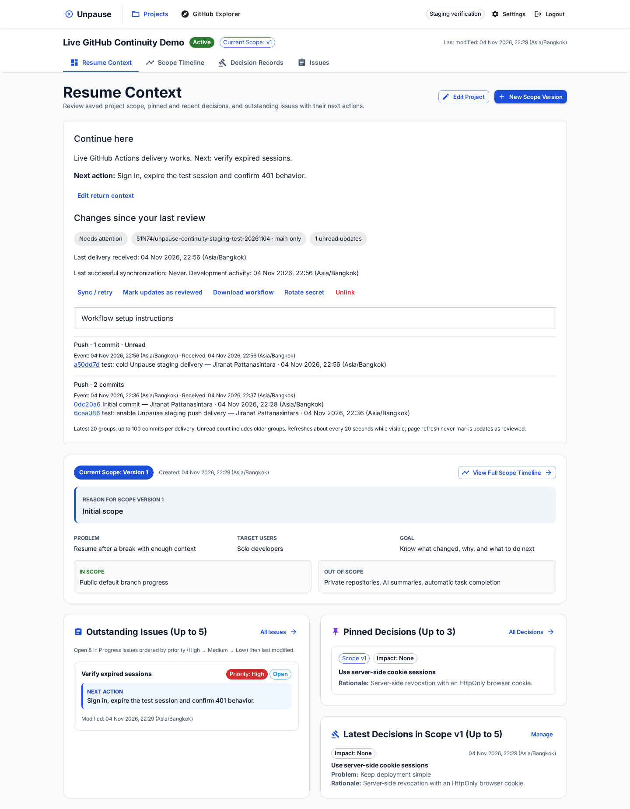
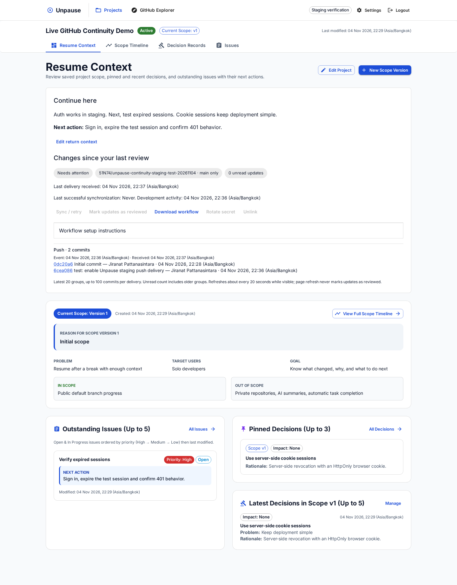

# ผลทดสอบ Unpause บน Render / Neon / GitHub Actions จริง

> ผลชุดนี้เป็น staging ก่อนปล่อย production ข้อความเรื่อง production ไม่เปลี่ยนแปลงหมายถึงช่วงทดสอบชุดนี้ ดูสถานะภายหลังใน [รายงาน production rollout](UNPAUSE_PRODUCTION_ROLLOUT_TH.md)

ทดสอบ deployment วันที่ 4 พฤศจิกายน 2026 · ตรวจข้อมูลคงอยู่และ browser หลังกลับมาวันที่ 5 พฤศจิกายน 2026

เวลาในเอกสารเป็น Asia/Bangkok เว้นแต่ระบุ UTC

## สภาพแวดล้อมที่สร้าง

- Render workspace: `Jiranat's workspace` ซึ่งผู้ใช้ยืนยันแล้ว
- Web service ใหม่: [unpause-continuity-staging](https://unpause-continuity-staging.onrender.com) · [Dashboard](https://dashboard.render.com/web/srv-dblktit9fdbs73c16jog)
- Render Free, Singapore, Docker, branch `codex/github-continuity`, ปิด auto deploy
- Neon project ใหม่: `unpause-staging` (`bitter-heart-13372336`) ในองค์กร Jiranat, Singapore, PostgreSQL 18
- Database `unpause_staging`, branch `staging`, compute 0.25 CU
- บัญชี Neon ไม่อนุญาตตั้ง suspend interval เป็น 300 วินาทีผ่าน API จึงใช้ default ของบัญชี ค่า endpoint ที่อ่านได้คือ `suspend_timeout_seconds=0`; ใช้สถานะที่อ่านได้จริงประกอบ ไม่อนุมานพฤติกรรม idle จากค่านี้อย่างเดียว
- Neon control plane รายงาน endpoint/compute เป็น `idle` เวลา 22:51:03 หลังหยุด application requests ([หลักฐาน](reports/live-staging/neon-idle-observation.json))
- Repository ทดสอบใหม่: [51N74/unpause-continuity-staging-test-20261104](https://github.com/51N74/unpause-continuity-staging-test-20261104) · ติดตาม `main`
- ใช้ข้อมูลและบัญชีทดสอบที่สร้างใหม่ ไม่ clone ฐานข้อมูลระบบหลัก และไม่แก้ service เดิม `unpause`

Service สร้างผ่าน Render MCP โดยตรงตาม config staging ไม่ใช่ Blueprint-managed resource ค่า secrets เก็บใน Render/GitHub และไฟล์ชั่วคราวที่จำกัดสิทธิ์ ไม่อยู่ใน repository หรือรายงานนี้

API สร้าง service ของ Render ไม่มี healthCheckPath ให้กำหนด ดังนั้น platform health check ของ staging ชุดนี้ใช้ TCP ตาม default ส่วน HTTP `/api/v1/health` ถูกเรียกทดสอบเองและตอบ `status=ok, database=ok` หลัง deploy

## เวอร์ชันที่ยืนยัน

- Deploy แรก `63e1bc0` ขึ้น live และ migration หมายเลข 1/2 ทำงานกับ Neon จริง
- พบปัญหา GitHub core API quota หมดระหว่างเชื่อม public repo บน Render: API ตอบ `429 GITHUB_RATE_LIMIT` ขณะที่ repository search ยังใช้งานได้
- แก้เฉพาะตัว resolve repository ให้ fallback ผ่าน public repository search เมื่อ core endpoint ติด rate limit โดยบังคับชื่อตรงกัน, `private=false`, `visibility=public`, stable ID และ default branch; ไม่รับ approximate match และไม่ส่ง GitHub credential ไป public metadata requests
- จำกัด timeout รวมของการ resolve ที่ 10 วินาที และเพิ่ม reset time จาก GitHub ในข้อความ error เมื่อมี header ให้
- Commit แก้ไข: `75919c5b3f2386d3697a0df69d218c0782cef7bd`
- [CI หลังแก้ — ผ่าน](https://github.com/51N74/Unpause/actions/runs/41859062441) รวม npm audit, Go/React/Node tests, race/vet, govulncheck, browser และ Docker build
- Render deploy `dep-dbll0ugae00c73c75a0g` ขึ้น **live** เวลา 22:35:23

Fallback นี้ช่วยให้เชื่อม repo ได้เมื่อ core quota เต็ม แต่ไม่ได้อ้างว่ากู้ commits ย้อนหลังได้ขณะ commits endpoint ยังติด quota การ catch-up จะแสดง error/Needs attention ตามจริง และยังอ่าน saved context/received activity ได้ การส่งจาก Actions ใช้ GitHub token ของ runner อ่าน metadata จาก repository ทดสอบแล้วส่งเข้า Unpause จึงทำงานได้แยกจาก public API catch-up

## ผล warm deployment จริง

[Actions sender run — success](https://github.com/51N74/unpause-continuity-staging-test-20261104/actions/runs/41859581406)

| จุดวัด | เวลา / ผล |
|---|---|
| Commit ของ push (`6cea0868…`) | 22:36:49 |
| Stored activity (`receivedAt`) | 22:37:00.172555 |
| Commit link ปรากฏใน browser ผ่าน polling | 22:37:10.271 |
| Commit → stored | **11.172 วินาที** |
| Stored → visible | **10.099 วินาที** |
| แหล่งข้อมูล | `actions`, delivery `actions:41859581406` |

เวลา commit จาก GitHub มีความละเอียดเป็นวินาที จึงไม่ควรตีความ push → stored ว่าแม่นระดับมิลลิวินาที ตัวเลขเป็น observation หนึ่งรอบ ไม่มีการรับประกันว่าเร็วเท่านี้ทุกครั้ง เวลารอ runner และเครือข่ายรวมอยู่ในช่วงแรก

ใช้ Chromium เปิด Resume อยู่ก่อน push จริง สร้าง workflow/secret/variable ใน repository ทดสอบแล้วให้ push-triggered workflow ส่งเข้า API จริง ไม่ใช้ GitHub mock หรือฐานข้อมูลในหน่วยความจำในผลชุดนี้

ตรวจ browser: commit ปรากฏโดยไม่ manual reload, reload ก่อนยืนยันแล้วยัง unread, กดยืนยันแล้วเป็น 0, แสดง Scope/Decision/next action เดิม, desktop/mobile ไม่มี horizontal overflow และไม่มี page error

หลักฐาน: [warm result JSON](reports/live-staging/warm-result.json)

## ความปลอดภัยและความถูกต้องบนระบบจริง

| กรณี | ผลที่สังเกต |
|---|---|
| Secret ไม่ถูกต้อง | 401 |
| Repository ID ไม่ตรง connection | 403 |
| ส่ง delivery ID เดิมซ้ำด้วย credential ที่ถูกต้อง | 200; sequence คงเดิม; จำนวน commits ยัง 2 |
| บัญชีทดสอบอีกเจ้าของอ่าน project/activity | 404 ทั้งสอง endpoint |
| Background integration | `Project.updatedAt` คงเดิม |
| Context ของเจ้าของ | Scope, pinned Decision พร้อม rationale, Issue/next action ยังอยู่ และ Issue ยัง Open |
| Cookie จาก login response จริง | Secure และ HttpOnly |

ตัวตรวจ cookie ครั้งแรกอ่าน attribute จากไฟล์ MozillaCookieJar ซึ่งไม่เก็บ HttpOnly จึงปรับตัวตรวจไปอ่าน Set-Cookie ของ response จริง และยืนยัน flags โดยไม่พิมพ์ค่าคุกกี้ ไม่พบว่าระบบตัด HttpOnly ออก

หลักฐาน: [security result JSON](reports/live-staging/security-result.json)

## ผลหลัง idle / cold start

**ผ่านการส่งจาก GitHub Actions หลัง idle จริง** โดยไม่เปิด browser เพื่อปลุก service ก่อนรับข้อมูล

| จุดวัด | เวลา / ผล (4 พฤศจิกายน) |
|---|---|
| เริ่มหยุด application requests | 22:39:16.503 |
| Neon รายงาน idle | 22:51:03 |
| Render shutdown instance เดิม | 22:54:07.214 |
| Push cold commit `a50dd7d…` | 22:56:34 |
| Actions run สร้าง | 22:56:37 |
| บรรทัดแรกใน runner log | 22:56:40.150 |
| เริ่ม sender step | 22:56:40.359 |
| Render instance ใหม่เริ่มฟัง port | 22:56:46.152 |
| Stored activity (`receivedAt`) | 22:56:53.255 |
| Sender ได้รับ HTTP 200 | 22:56:53.411 |
| Commit → stored | **19.255 วินาที** |
| เริ่ม sender step → stored | **ประมาณ 12.9 วินาที** รวมอ่าน metadata, network และ cold start ไม่ใช่เวลาของ Render เพียงอย่างเดียว |
| แหล่งข้อมูล | `actions`, delivery `actions:41862787172` |

หยุด requests ก่อน push ประมาณ 17 นาที 17 วินาที; ไม่ได้ตั้ง keep-alive หรือให้ browser polling ระหว่าง idle ได้ยืนยัน Neon idle และ Render shutdown ก่อน push แล้ว ตัว sender สำเร็จในรอบแรกโดย log ไม่มี delivery failure จึงไม่ได้อ้างว่ารอบนี้พิสูจน์ network retry จาก failure จริง (bounded retry มี unit tests และ warm/staging ใช้ workflow เดียวกัน)

[Actions cold sender — success](https://github.com/51N74/unpause-continuity-staging-test-20261104/actions/runs/41862787172) · [cold result](reports/live-staging/cold-result.json) · [runner/Render evidence](reports/live-staging/cold-actions-evidence.json) · [Render idle](reports/live-staging/render-idle-observation.json)

วันที่ 5 พฤศจิกายนตรวจข้อมูลผ่าน API และ Chromium จริง: cold SHA อยู่ครั้งเดียว, 2 กลุ่ม/3 unique commits, unread เท่ากับ 1 และไม่หายหลัง reload, return note ที่แก้ระหว่าง warm test ยังคงอยู่, `Project.updatedAt` ไม่เปลี่ยน, Scope/Decision/Issue/next action เดิมยังแสดง ไม่พบ browser page error หรือ document horizontal overflow บน desktop/mobile ([ผล browser](reports/live-staging/cold-browser-result.json))

ไม่ได้วัด cold stored → visible latency เพราะปิด browser ระหว่าง delivery เพื่อทดสอบรับข้อมูลโดยไม่มี session; ภาพ UI เป็นการกลับมาตรวจวันถัดไป ส่วน warm test ด้านบนวัด polling latency จริงไว้แล้ว

**ความคลาดเคลื่อนของสถานะ GitHub:** ขณะติดตามคืนวันที่ 4 พฤศจิกายน API ทั้ง connector และ direct API เคยรายงาน `queued` ต่อเนื่อง และ cancel/force-cancel ตอบ HTTP 409 ก่อนผู้ใช้สั่งพัก แต่หลักฐานสุดท้ายจาก runner log, Render startup และ `receivedAt` สอดคล้องกันว่าส่งสำเร็จ 22:56:53 ค่า run `updated_at` เป็น 23:17:49 ไม่ควรใช้เวลาที่ polling รายงาน queued หรือ updated_at แทนเวลาส่งจริง ยังไม่ได้ระบุสาเหตุของความคลาดเคลื่อนนี้

## สถานะและข้อจำกัด

- ผ่านการตรวจทางเทคนิคที่ระบุ: dependency audits, CI จริง, production Docker build, migration บน Neon, Actions warm/idle delivery, browser และ security checks
- `npm audit` ไม่พบช่องโหว่; Go ไม่พบช่องโหว่ที่กระทบ code/imported packages แต่ยังบันทึก module-only advisory ของ OpenPGP ที่ไม่ได้ใช้ไว้ใน [รายงาน dependencies](UNPAUSE_DEPENDENCY_REMEDIATION_TH.md)
- `Needs attention` ยังปรากฏเพราะ public GitHub API catch-up ติด quota; last delivery และ activity จาก Actions ยืนยันสำเร็จ ไม่อ้างว่า public catch-up ผ่านบน staging รอบนี้ การกู้ข้อมูล/แสดง error ตรวจใน automated tests แล้ว
- ใช้ real staging เพียงตัวอย่างเดียว ไม่รับประกัน latency และไม่ได้ทำ load test หรือ penetration test ครอบคลุมทุกช่องทาง
- ยังไม่มีการทดลองกับเพื่อนร่วมชั้นเพื่อวัดว่าอ่านแล้วเข้าใจ “เปลี่ยนอะไร/ทำไม/ทำอะไรต่อ” ได้เร็วขึ้น ไม่อ้างผล usability จาก automated browser checks
- Production เดิม `unpause` อยู่ branch `main`, `updatedAt=2026-10-29T14:47:31.946805Z` ไม่เปลี่ยน; staging ยัง pin code `75919c5` และปิด auto deploy ไม่มี recurring automation
- Resource staging/repository ทดสอบคงไว้ให้ตรวจซ้ำ ไม่ได้ลบระหว่างปิดงาน; migration และ source ที่ทดสอบไม่มีการแก้เพิ่มเติมหลัง CI ผ่าน

ภาพหลังกลับมาตรวจวันที่ 5 พฤศจิกายน:

[ภาพ mobile หลัง idle](reports/live-staging/after-idle-mobile.png)

ภาพระหว่าง warm test (ข้อมูลทดสอบ):

[ภาพ mobile](reports/live-staging/mobile.png)

อ้างอิง platform: [Render deployments](https://render.com/docs/deploys), [Render health checks](https://render.com/docs/health-checks), [Render Free idle behavior](https://render.com/docs/free)
